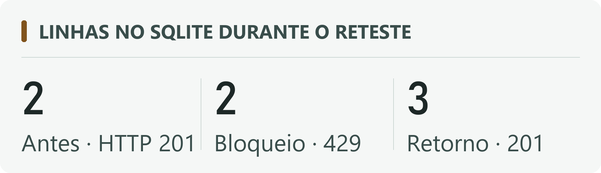

# Rate limiting na borda com Cloudflare

**Um HTTP 429 antes da API, verificado até o SQLite.**

Em 24/11/2026, retestei o limite de requisições de um formulário da VELAR em homologação. Usei dados fictícios, um Cloudflare Worker, uma API isolada e um banco descartável.

<picture>
  <source media="(prefers-color-scheme: dark)" srcset="docs/img/resumo-escuro.png">
  
</picture>

[Registro do reteste](docs/evidencias.md) · [Resumo para entrevista](docs/entrevista.md)

## Como comprovei o bloqueio

Cruzei o ID do envio entre a resposta HTTP, a auditoria do Worker, os registros da API e o banco. O envio bloqueado apareceu apenas na auditoria do Worker. A API recebeu os mesmos dois envios que já estavam registrados no SQLite. Doze segundos depois, um novo envio recebeu **HTTP 201** e gravou a terceira linha. [Tabela da rodada final](docs/evidencias.md#registro-sanitizado-da-rodada-final)

O diagnóstico também registrou falhas de prontidão na rota temporária e reproduziu uma exceção no tratamento de redirecionamento. O reteste confirmou o fluxo em homologação usando o contador distribuído do Cloudflare. [Diagnóstico por camada](docs/evidencias.md#diagnóstico-por-camada)

## Como rodar a demonstração

Com **Node.js 24 ou superior**, rode na raiz do repositório.

```sh
node demo/retest.mjs
```

A demonstração usa duas portas efêmeras em loopback, relógio de teste e SQLite descartável. O script confirma que o bloqueio preserva a contagem de chamadas e de linhas, verifica a retomada e a integridade do banco e limpa os recursos. [Código do reteste local](demo/retest.mjs)
