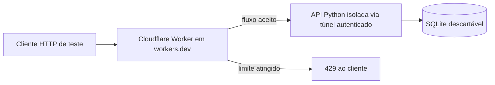

# Evidências do reteste de homologação

**Data** 24/11/2026 · **Escopo** `POST /api/lead` com dados de `example.test`

## Critério de aceite

Correlacionar o mesmo ID na resposta HTTP, na auditoria de entrada do Worker, no registro de chamadas ao POST da API e no SQLite. O ID bloqueado precisa constar na auditoria do Worker e ficar ausente das duas fontes que comprovam a chegada e a gravação. A contagem de ambas deve permanecer igual antes e depois do bloqueio.

## Registro sanitizado da rodada final

| Amostra | HTTP e origem da resposta | Chamadas ao POST da API | Linhas no SQLite |
| --- | --- | ---: | ---: |
| Três checagens iniciais | `404`, código Cloudflare `1042` | 0 | 0 |
| Seis checagens seguintes | Seis `200 ready` consecutivos do Worker | 0 | 0 |
| `legacy-1`, diagnóstico | `502 exception_audit_invalid_redirect_value` do Worker | 0 | 0 |
| `lead-1` | `201` da API | 1 | 1 |
| `lead-2` | `201` da API | 2 | 2 |
| `lead-3` | `429 worker_rate_limited` do Worker | 2 | 2 |
| `recovery-1`, após 12 segundos | `201` da API | 3 | 3 |

O Worker registrou `lead-3` em uma rota de auditoria separada. A API de leads e o banco permaneceram sem esse ID, inclusive depois da recuperação. O `PRAGMA integrity_check` retornou `ok`. A API, o túnel e o SQLite descartável foram removidos ao final.

## Diagnóstico por camada

- **`404/1042` durante a prontidão.** O corpo da resposta era `error code: 1042` e os IDs estavam ausentes da auditoria. O Cloudflare documenta o código para URLs `workers.dev` sem um Worker disponível para atendê-las. O executor passou a exigir seis respostas `200 ready` em conexões novas, com dois segundos entre tentativas e reinício da sequência a cada falha. A causa interna da indisponibilidade intermitente não foi determinada. [Códigos de erro do Cloudflare Workers](https://developers.cloudflare.com/workers/observability/errors/)
- **`500/1101` no ensaio inicial.** A pilha original não foi capturada. Ao repetir a chamada antiga em uma variante instrumentada, o runtime lançou um `TypeError` na auditoria e a resposta indicou a opção de redirecionamento inválida. A correção usou `manual` e rejeitou respostas `3xx` antes de encaminhá-las ao cliente. [Validação no código do runtime workerd](https://github.com/cloudflare/workerd/blob/main/src/workerd/api/http.c%2B%2B)
- **`429` esperado no controle de borda.** O binding tinha um limiar de teste de uma requisição por IP em dez segundos. A rodada aceitou dois envios antes do bloqueio, comportamento compatível com a atualização assíncrona do contador. A evidência de aceite é o bloqueio atribuído ao Worker com o mesmo estado na API e no SQLite. [Binding Rate Limiting](https://developers.cloudflare.com/workers/runtime-apis/bindings/rate-limit/)

O ensaio avalia o fluxo em homologação. A cobertura da regra nativa do WAF, o comportamento sob carga e métricas de produção ficam fora dos resultados. A demonstração pública reproduz o critério de aceite em loopback com um limitador local e uma API fictícia.
